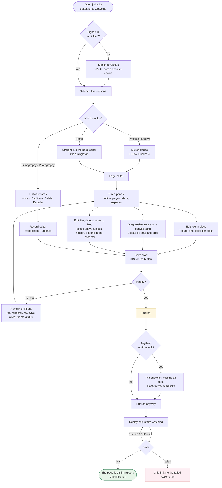
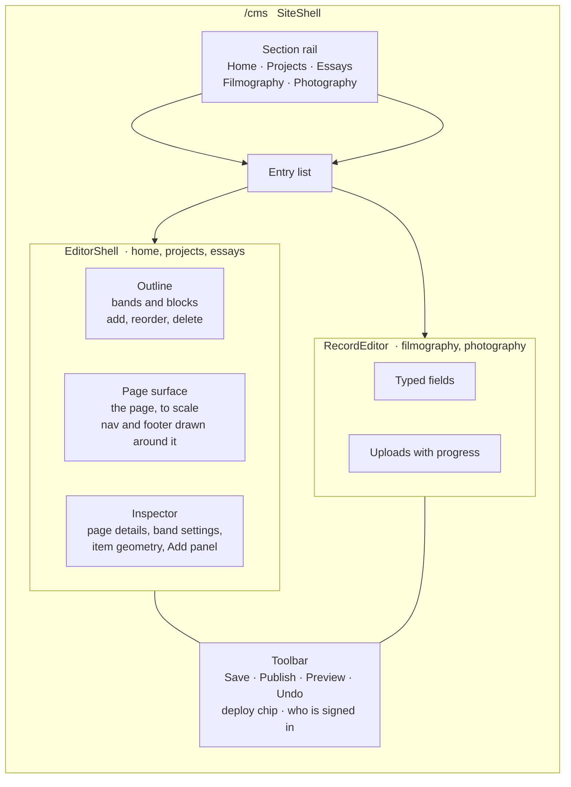
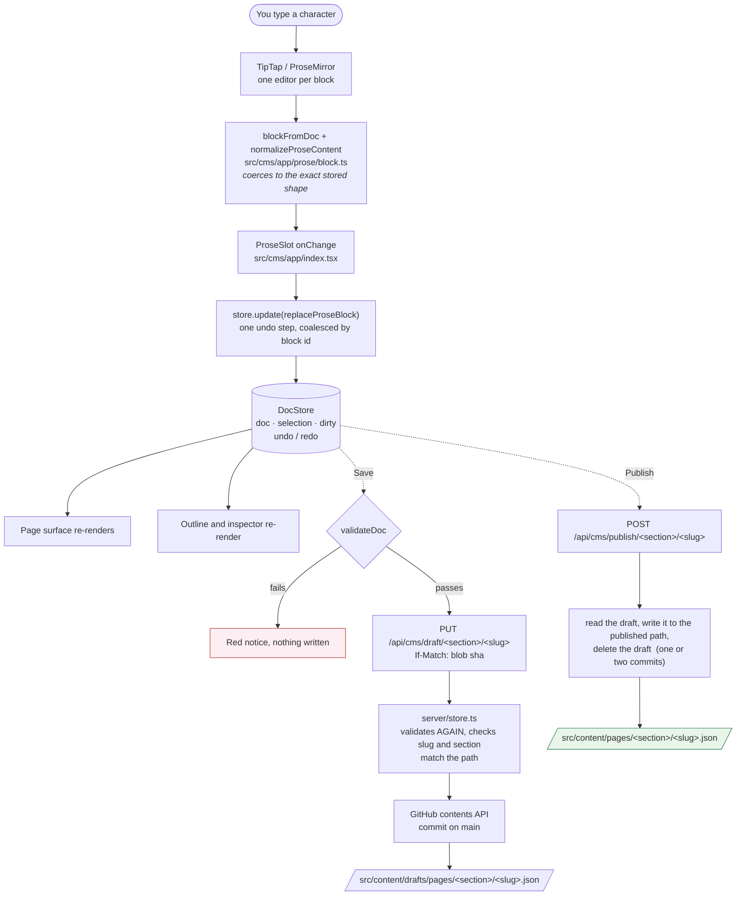
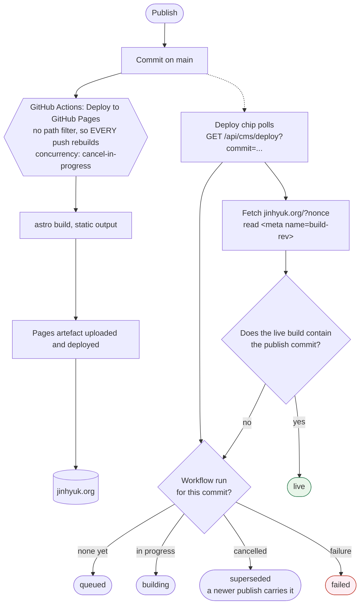
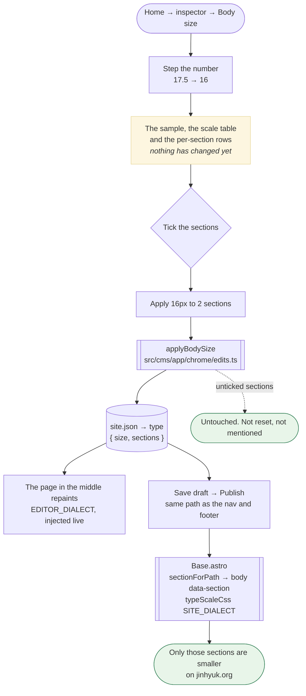

# How the editor works

Four views of the same machine: what you do, what the screen is made of, where
a keystroke ends up, and what happens between Publish and the live page.

The diagrams are Mermaid. GitHub renders them in place. In VS Code you need a
Mermaid preview extension, or read the labelled prose under each one, which
says the same thing.

---

## 1. The UX flow

What you actually do, from opening the editor to seeing the change on
jinhyuk.org.

Two things that are easy to miss from the picture:

- **The body size is a setting, under Home.** One number, applied to whichever
  sections you tick, with the scale and the affected pages shown before you
  apply. See section 4b.
- **A whole essay can be pasted in at once.** Copy from Notion, Docs or a
  web page and paste into a text block: headings, paragraphs, lists and
  quotes arrive as separate blocks, in order, with bold, italics, colour and
  links intact. An empty block is replaced; a block with text in it keeps its
  text and the pasted blocks follow. Images, tables and code blocks have no
  home in a text band, so they are left out and the editor says how many.
- **Save and Publish are different commits.** Save writes a working copy under
  `src/content/drafts/`, which the site build ignores and which no longer
  triggers a deploy. Publish moves that file into `src/content/pages/` and
  deletes the draft. You cannot publish something you have not saved, and
  Publish saves for you if you forgot.
- **Publish asks once** when the page has something worth knowing about:
  an image with no alt text, empty rows, a link into the editor. Warnings,
  never a block; a clean page publishes on the first press.
- **Unsaved work is copied into this browser** on a debounce and offered
  back if the tab dies. It is never sent anywhere, and it is offered, never
  applied.
- **Dark mode is on the surface; phone width is only in Preview.** The mobile
  rules are viewport media queries, so a narrowed surface cannot fire them.
  The "Phone" button opens the preview at 390 in a real iframe.
- **A page can be taken off the site without deleting it** (`hidden` in the
  inspector): no page is built at its address, and it stays here, editable.
- **A page can be renamed or deleted** from the entry list. A rename moves
  the file, its draft and `meta.slug` in one commit, and leaves the old
  address redirecting.

---

## 2. What the screen is made of

The page surface is the part that matters most and the part most likely to
lie. It draws the page with the **real renderer** (`renderDoc`) and a
**mirrored copy** of the page's typography (`SHELL_CSS`, not `doc.css`). That
mirror is where every editor-versus-site drift has come from. See
[`consistency.md`](consistency.md).

---

## 3. Where a keystroke ends up

Four invariants worth knowing by heart:

1. **One ProseBlock is one top-level node.** A paragraph block's ProseMirror
   schema literally has no heading, no list and no blockquote in it. That is
   why Enter has to be caught and turned into "cut this block in two" rather
   than left to make a second paragraph.
2. **The document is validated twice**, once in the browser before the request
   and once on the server before the commit, against the same `schema.ts`. A
   draft on disk is always loadable.
3. **Every write carries the blob sha it expects.** A second tab that saved
   first gets you a 409 with an explanation, not a silent overwrite.
4. **Editor state never enters the document.** Selection, hover, zoom and
   drag deltas live in the store. Every schema object is `.strict()`, so a
   stray key is a validation error rather than something that quietly ships.

---

## 4. Publish to live

The chip trusts the **live page**, not the green tick. A finished run means
Pages accepted the artefact; it does not mean the CDN is handing it to you.
So every page carries `<meta name="build-rev">` with the commit it was built
from, and a publish is live when the page being served was built from that
commit or from something after it. "Or after it" is what stops two quick
publishes in a row reading as a failure, since the first run gets cancelled
and its content rides along in the second.

**A draft save no longer triggers a rebuild.** The workflow ignores a push
that only touches `src/content/drafts/`, so saving a working copy costs
nothing. Publishing touches the published tree in the same commit, so it
still builds.

---

## 4b. Changing the body size

The one setting that changes every page at once, so it is the one that shows
you what it will do before it does it.

**One generator, two dialects.** `src/cms/styles/type-scale.ts` holds the base
size of every kind of running text and scales them all by one ratio. The site
gets selectors scoped by `body[data-section='…']`; the editor gets the same
roles under `.cms-surface--…`, because the editor does not load `doc.css` and
names the same things differently. They cannot produce different numbers,
because they call one function, and
`styles/verify-type-scale-browser.mjs` measures both in a browser to prove the
rules actually land.

**What moves:** paragraphs, list items, quotes and callouts, leading included.
**What does not:** headings, captions, the nav, the footer, buttons.

**Nothing set is nothing generated.** A site at the design's own 17.5px
produces an empty stylesheet and no `type` key in `site.json`, and builds
byte-for-byte what it built before the feature existed.

---

## 5. Where the content lives

| Section | Shape | Editor | Published file | Draft file | Live URL |
| --- | --- | --- | --- | --- | --- |
| Home | singleton | document | `src/content/pages/home.json` | `src/content/drafts/pages/home.json` | `/` |
| Projects | collection | document | `src/content/pages/projects/<slug>.json` | `src/content/drafts/pages/projects/<slug>.json` | `/projects/<slug>/` |
| Essays | collection | document | `src/content/pages/essays/<slug>.json` | same, under `drafts/` | `/essays/<slug>/` |
| Filmography | collection | records | `src/content/data/filmography.json` | same, under `drafts/` | `/filmography/` (no per-film page) |
| Photography | collection | records | `src/content/data/photography.json` | same, under `drafts/` | `/photography/<slug>/` |
| Nav and footer, and body size | one file | chrome panel, under Home | `src/content/data/site.json` | same, under `drafts/` | every page |
| Old addresses | one file | written by a rename | `src/content/data/redirects.json` | n/a | the URLs it lists |

Uploads go to `public/media/<section>/<key>/` and are served at
`/media/<section>/<key>/<file>`.

The draft tree is a literal mirror of the published tree: swap `src/content/`
for `src/content/drafts/` and that is the path. No section has its own rule.

**Two deployments, one repository.**

| | Built with | Output | Where | What it is |
| --- | --- | --- | --- | --- |
| The site | `astro build` | static | GitHub Pages, jinhyuk.org | what readers get |
| The editor | `PUBLIC_EDITOR_BUILD=1 astro build` | server | Vercel, jinhyuk-editor.vercel.app | the CMS, the API routes, the preview |

The editor commits to `main` in `ryan-choi-jh/jinhyuk.org` (override with
`CMS_BRANCH`). That commit is what triggers the site build. The two
deployments never talk to each other; git is the whole interface between
them.
