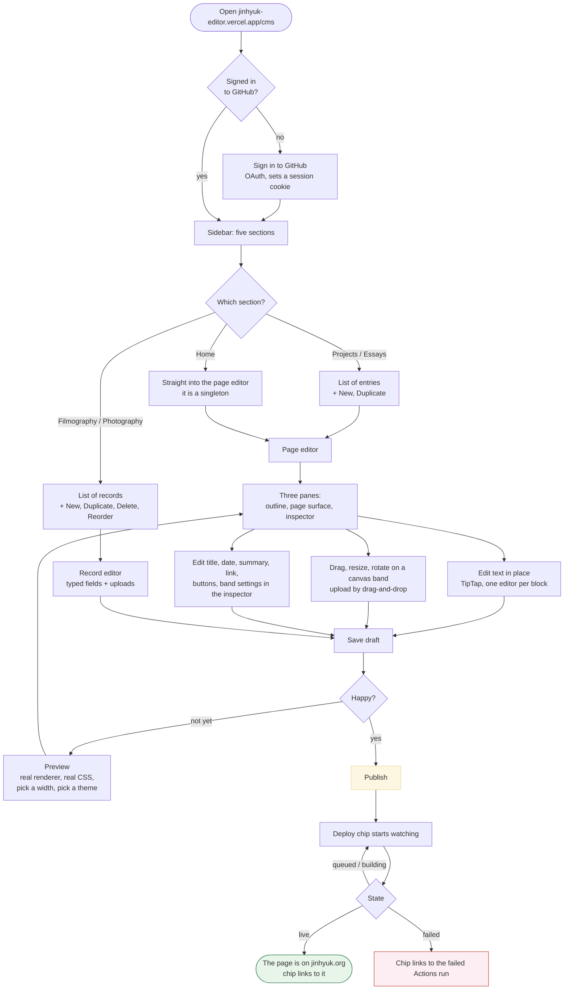
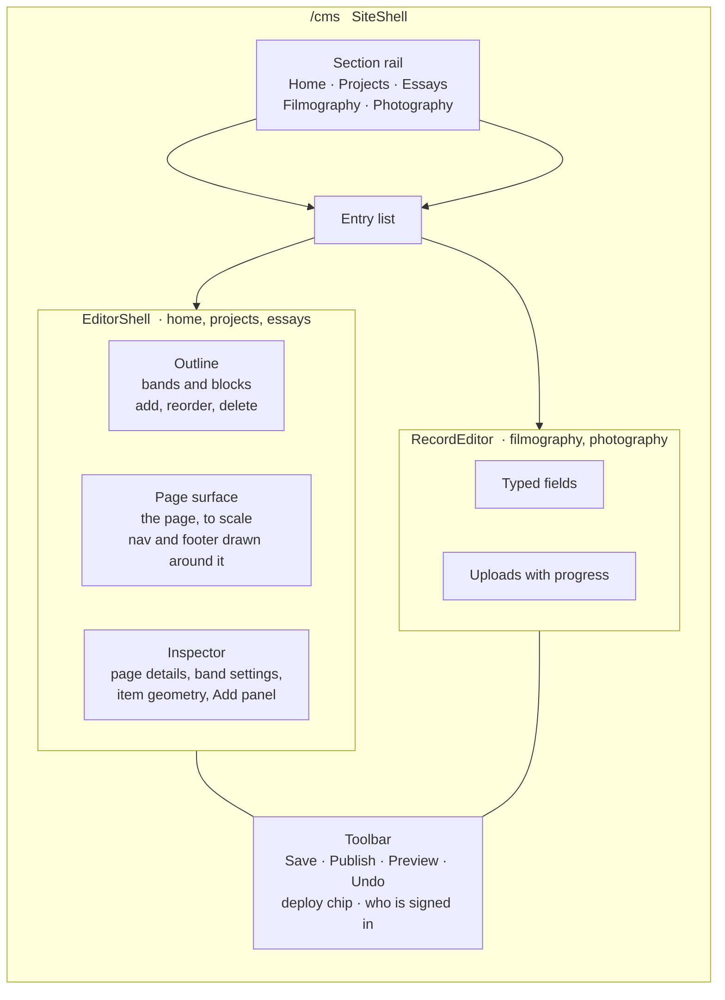

# How the editor works

Four views of the same machine: what you do, what the screen is made of, where
a keystroke ends up, and what happens between Publish and the live page.

The diagrams are Mermaid. GitHub renders them in place. In VS Code you need a
Mermaid preview extension, or read the labelled prose under each one, which
says the same thing.

---

## 1. The UX flow

What you actually do, from opening the editor to seeing the change on
jinhyuk.org.

Two things that are easy to miss from the picture:

- **Save and Publish are different commits.** Save writes a working copy under
  `src/content/drafts/`, which the site build ignores. Publish moves that file
  into `src/content/pages/` and deletes the draft. You cannot publish something
  you have not saved, and Publish saves for you if you forgot.
- **Preview is the only place you can check dark mode and phone width.** The
  editing surface is always light and always the desktop measure.

---

## 2. What the screen is made of

The page surface is the part that matters most and the part most likely to
lie. It draws the page with the **real renderer** (`renderDoc`) and a
**mirrored copy** of the page's typography (`SHELL_CSS`, not `doc.css`). That
mirror is where every editor-versus-site drift has come from. See
[`consistency.md`](consistency.md).

---

## 3. Where a keystroke ends up

Four invariants worth knowing by heart:

1. **One ProseBlock is one top-level node.** A paragraph block's ProseMirror
   schema literally has no heading, no list and no blockquote in it. That is
   why Enter has to be caught and turned into "cut this block in two" rather
   than left to make a second paragraph.
2. **The document is validated twice**, once in the browser before the request
   and once on the server before the commit, against the same `schema.ts`. A
   draft on disk is always loadable.
3. **Every write carries the blob sha it expects.** A second tab that saved
   first gets you a 409 with an explanation, not a silent overwrite.
4. **Editor state never enters the document.** Selection, hover, zoom and
   drag deltas live in the store. Every schema object is `.strict()`, so a
   stray key is a validation error rather than something that quietly ships.

---

## 4. Publish to live

The chip trusts the **live page**, not the green tick. A finished run means
Pages accepted the artefact; it does not mean the CDN is handing it to you.
So every page carries `<meta name="build-rev">` with the commit it was built
from, and a publish is live when the page being served was built from that
commit or from something after it. "Or after it" is what stops two quick
publishes in a row reading as a failure, since the first run gets cancelled
and its content rides along in the second.

**A draft save also triggers a full rebuild and deploy.** The workflow has no
path filter, so saving a working copy costs an Actions run that changes
nothing on the site. See [`roadmap.md`](roadmap.md) F11.

---

## 5. Where the content lives

| Section | Shape | Editor | Published file | Draft file | Live URL |
| --- | --- | --- | --- | --- | --- |
| Home | singleton | document | `src/content/pages/home.json` | `src/content/drafts/pages/home.json` | `/` |
| Projects | collection | document | `src/content/pages/projects/<slug>.json` | `src/content/drafts/pages/projects/<slug>.json` | `/projects/<slug>/` |
| Essays | collection | document | `src/content/pages/essays/<slug>.json` | same, under `drafts/` | `/essays/<slug>/` |
| Filmography | collection | records | `src/content/data/filmography.json` | same, under `drafts/` | `/filmography/` (no per-film page) |
| Photography | collection | records | `src/content/data/photography.json` | same, under `drafts/` | `/photography/<slug>/` |
| Nav and footer | one file | chrome panel, under Home | `src/content/data/site.json` | same, under `drafts/` | every page |

Uploads go to `public/media/<section>/<key>/` and are served at
`/media/<section>/<key>/<file>`.

The draft tree is a literal mirror of the published tree: swap `src/content/`
for `src/content/drafts/` and that is the path. No section has its own rule.

**Two deployments, one repository.**

| | Built with | Output | Where | What it is |
| --- | --- | --- | --- | --- |
| The site | `astro build` | static | GitHub Pages, jinhyuk.org | what readers get |
| The editor | `PUBLIC_EDITOR_BUILD=1 astro build` | server | Vercel, jinhyuk-editor.vercel.app | the CMS, the API routes, the preview |

The editor commits to `main` in `ryan-choi-jh/jinhyuk.org` (override with
`CMS_BRANCH`). That commit is what triggers the site build. The two
deployments never talk to each other; git is the whole interface between
them.
